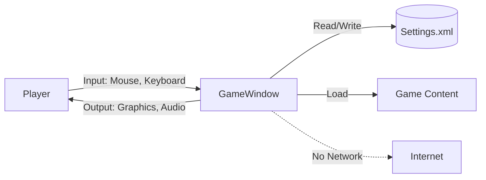
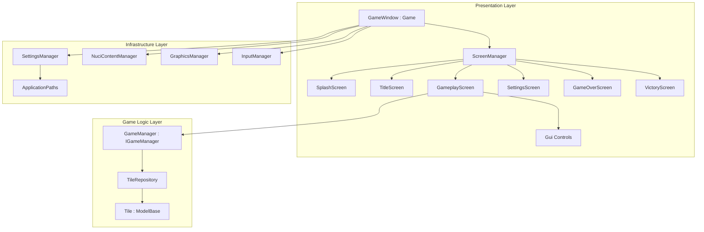
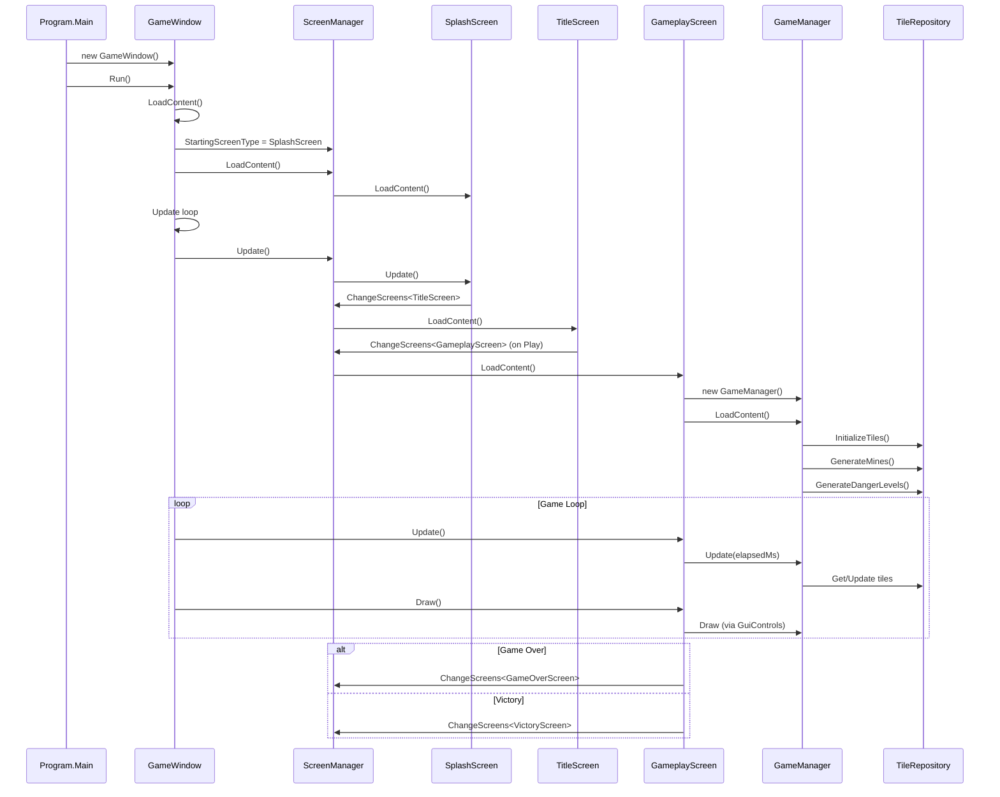
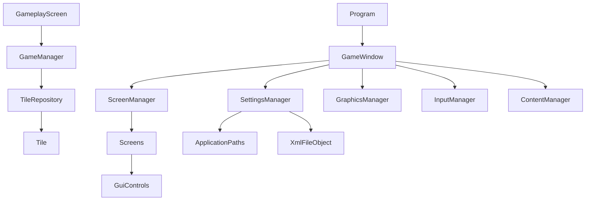

# Minesweeper Architecture

This document describes the current architecture of the Minesweeper desktop application, a cross-platform reimplementation of the classic puzzle game built with .NET 10.0 and MonoGame 3.8.4.

## 📑 Table of Contents

- [Purpose](#-purpose)
- [System Context](#-system-context)
- [Architectural Style](#-architectural-style)
- [Runtime Flow](#-runtime-flow)
- [Components](#-components)
- [Architectural Areas](#-architectural-areas)
- [Data Architecture](#-data-architecture)
- [Interfaces and Integrations](#-interfaces-and-integrations)
- [Cross-Cutting Concerns](#-cross-cutting-concerns)
- [Dependency Direction and Rules](#-dependency-direction-and-rules)
- [External Dependencies](#-external-dependencies)
- [Deployment and Operations](#-deployment-and-operations)
- [Compatibility Contracts](#-compatibility-contracts)
- [Testing and Verification](#-testing-and-verification)
- [Design Constraints](#-design-constraints)
- [Source Map](#-source-map)
- [Related Documentation](#-related-documentation)

## 🎯 Purpose

Minesweeper is a self-contained desktop puzzle game that runs locally without network connectivity. The architecture separates game logic from presentation, uses a screen-based UI framework, and persists only user preferences to a local XML file. The intended audience is developers maintaining or extending the codebase.

## 🌐 System Context



The principal external boundaries are:
- **Player Input:** Mouse clicks (left/right) for tile clearing/flagging, keyboard (N/R for restart, Escape for menu)
- **Graphics Output:** MonoGame DesktopGL rendering to window
- **Audio Output:** MonoGame audio via OpenAL
- **Settings Persistence:** Local XML file at platform-specific user data directory
- **Game Content:** Compiled MonoGame content (fonts, textures) loaded at startup
- **No Network Boundary:** The application makes no network connections

## 🏗️ Architectural Style

The application follows a **Layered Architecture** with **Screen-Based UI** pattern:



The principal architecture boundaries are:
- **Presentation Layer:** MonoGame `Game` subclass, `ScreenManager`, screens, and GUI controls — owns rendering, input routing, and screen transitions
- **Game Logic Layer:** `IGameManager` implementation, `TileRepository`, `Tile` model — owns game rules, state, and win/loss conditions
- **Infrastructure Layer:** Settings, content, graphics, input managers (NuciXNA singletons) — provides cross-cutting services

## 🔄 Runtime Flow



The principal runtime sequence is:
1. **Initialisation:** `Program.Main` creates `GameWindow`, prepares user data directory, starts MonoGame loop
2. **Content Loading:** `GameWindow.LoadContent` initialises graphics, content, settings, and screen manager with `SplashScreen`
3. **Splash → Title:** `SplashScreen` transitions to `TitleScreen` after delay
4. **Title → Gameplay:** Player selects Play; `TitleScreen` transitions to `GameplayScreen`
5. **Gameplay Loop:** `GameplayScreen` owns `GameManager`; processes input, updates game state, renders board and info bar
6. **Game End:** On win/loss, `GameplayScreen` transitions to `VictoryScreen` or `GameOverScreen` after delay
7. **Restart/Menu:** Player can restart (N/R) or return to title (Escape)
8. **Shutdown:** Settings saved on screen unload; MonoGame disposes resources

## 🧩 Components

| Component | Responsibility | Principal Dependencies | Lifetime or Ownership |
|-----------|----------------|------------------------|-----------------------|
| `Program` | Entry point; prepares file system; starts game loop | `GameWindow`, `ApplicationPaths` | Singleton (process lifetime) |
| `GameWindow` | MonoGame `Game` host; graphics device; root update/draw | `ScreenManager`, `GraphicsManager`, `SettingsManager`, `InputManager`, `FpsIndicator` | Singleton (process lifetime) |
| `ScreenManager` (NuciXNA) | Screen stack, transitions, content loading | Screens (`IScreen`), `SpriteBatch` | Singleton (process lifetime) |
| `SplashScreen` | Animated logo display; auto-advances to title | `ScreenManager` | Transient (single display) |
| `TitleScreen` | Main menu; navigation to gameplay/settings | `ScreenManager` | Transient (menu lifetime) |
| `GameplayScreen` | Core gameplay; owns `GameManager`; input handling | `GameManager`, `GuiInfoBar`, `GuiGameBoard`, `InputManager` | Transient (per game session) |
| `SettingsScreen` | Audio/graphics preference editing | `SettingsManager`, `ScreenManager` | Transient (settings lifetime) |
| `GameOverScreen` | Defeat display; restart or return to title | `ScreenManager` | Transient (post-game) |
| `VictoryScreen` | Victory display; restart or return to title | `ScreenManager` | Transient (post-game) |
| `GameManager` | Game rules, state, win/loss, timer | `TileRepository`, `GameDefines`, `Random` | Per-session (owned by `GameplayScreen`) |
| `TileRepository` | In-memory tile grid storage and queries | `Tile` | Per-session (owned by `GameManager`) |
| `Tile` | Immutable-identity model: position, mine, danger, flag, cleared | `ModelBase` | Per-tile (owned by `TileRepository`) |
| `SettingsManager` | Singleton settings persistence (XML) | `ApplicationPaths`, `XmlFileObject` (NuciDAL) | Singleton (process lifetime) |
| `ApplicationPaths` | Platform-specific path resolution | `Environment.SpecialFolder` | Static (process lifetime) |
| `GuiInfoBar` | Top bar: timer, mine count, flags remaining | `GameManager` | Per-session (owned by `GameplayScreen`) |
| `GuiGameBoard` | Grid rendering; tile visuals; mouse hit-testing | `GameManager`, `NuciXNA.Primitives` | Per-session (owned by `GameplayScreen`) |
| `FpsIndicator` | Debug overlay: frame rate counter | `GraphicsDevice` | Singleton (process lifetime) |

## 🗂️ Architectural Areas

### Presentation Layer

Paths:
- `Minesweeper/GameWindow.cs`
- `Minesweeper/Gui/Screens/`
- `Minesweeper/Gui/Controls/`
- `Minesweeper/Gui/Helpers/`
- `Minesweeper/Gui/FpsIndicator.cs`

Responsibilities:
- MonoGame host initialisation and game loop
- Screen lifecycle and transitions
- Input routing (keyboard, mouse) to active screen
- Rendering via `SpriteBatch`
- GUI control layout and drawing

Boundary rules:
- Screens must not reference each other directly; use `ScreenManager.ChangeScreens<T>()`
- GUI controls are registered with `GuiManager.Instance` and owned by their screen
- No game logic in screens or controls; delegate to `IGameManager`

### Game Logic Layer

Paths:
- `Minesweeper/GameLogic/GameManagers/IGameManager.cs`
- `Minesweeper/GameLogic/GameManagers/IGameLogicManager.cs`
- `Minesweeper/GameLogic/GameManagers/GameManager.cs`
- `Minesweeper/Repositories/`
- `Minesweeper/Models/`

Responsibilities:
- Game rules: mine placement, danger calculation, flood-fill clearing
- Game state: timer, alive/running/completed flags, flag count
- Tile grid management via repository pattern
- Win/loss detection

Boundary rules:
- `IGameManager` is the only contract exposed to presentation layer
- `TileRepository` encapsulates all tile storage; `GameManager` never uses arrays directly
- `Tile` is a pure data model; no behaviour
- Deterministic logic (except `Random` for mine placement); no external dependencies

### Infrastructure Layer

Paths:
- `Minesweeper/Settings/`
- `Minesweeper/Content/Content.mgcb`

Responsibilities:
- Settings persistence (XML serialisation via NuciDAL)
- Platform-specific path resolution
- Content pipeline (MonoGame Content Builder)
- NuciXNA singleton services: graphics, input, content, GUI

Boundary rules:
- Singletons accessed via `Instance` property; no direct instantiation
- Settings loaded once at startup; saved on `GameplayScreen` unload
- Content loaded via `NuciContentManager` at `GameWindow.LoadContent`

## 💾 Data Architecture

```mermaid
flowchart LR
    UserPrefs[User Preferences] -->|XML Serialisation| SettingsManager
    SettingsManager -->|Read/Write| SettingsFile[(Settings.xml)]
    GameManager -->|In-Memory| TileRepository
    TileRepository -->|Tile[]| Tile
    Content[Compiled Assets] -->|Load| NuciContentManager
    NuciContentManager -->|Fonts, Textures| GameWindow
```

| Data or Store | Owner | Representation and Storage | Lifecycle or Consistency |
|---------------|-------|----------------------------|--------------------------|
| `SettingsManager` (AudioSettings, GraphicsSettings, DebugMode) | `SettingsManager` | XML file at `ApplicationPaths.SettingsFile` | Loaded at startup; saved on `GameplayScreen` unload; survives process restart |
| `Tile[]` grid (TableSize × TableSize) | `TileRepository` | In-memory `Dictionary<string, Tile>` keyed by `"X,Y"` | Created per `NewGame()`; discarded on screen unload or new game |
| `GameManager` state (GameTime, Alive, IsRunning, FlagsPlaced) | `GameManager` | In-memory fields | Reset per `NewGame()`; updated each `Update()` call |
| MonoGame Content (fonts, textures) | `NuciContentManager` | Compiled `.xnb` files in `Content/bin/DesktopGL/Content/` | Built at compile time; loaded once at `GameWindow.LoadContent` |

## 🔌 Interfaces and Integrations

| Interface or Integration | Direction | Contract | Owner | Failure Semantics |
|--------------------------|-----------|----------|-------|-------------------|
| `IGameManager` | Inbound (Presentation → Logic) | `LoadContent`, `UnloadContent`, `Update`, `GetTile`, `GetAllTiles`, `ClearTile`, `FlagTile`, `NewGame`, properties | `GameManager` | Invalid coordinates return default/ignore; no exceptions |
| `ScreenManager.ChangeScreens<T>()` | Inbound (Screen → ScreenManager) | Generic screen transition | `ScreenManager` (NuciXNA) | Throws if `T` not registered; screens handle gracefully |
| `InputManager` events | Inbound (Framework → Screen) | `KeyboardKeyPressed`, `MouseButtonPressed` | `InputManager` (NuciXNA) | Events fire on active window; screens subscribe/unsubscribe in `DoLoadContent`/`DoUnloadContent` |
| `SettingsManager.Instance` | Bidirectional | `LoadContent`, `SaveContent`, `Update`, properties | `SettingsManager` | File I/O failures logged; defaults used if missing/corrupt |
| `NuciContentManager.Instance.LoadContent` | Inbound (GameWindow → Content) | `LoadContent(ContentManager, GraphicsDevice)` | `NuciContentManager` (NuciXNA) | Missing assets throw at load time (build-time guarantee) |
| `GraphicsManager.Instance` | Bidirectional | `SpriteBatch`, `GraphicsDeviceManager`, `ApplyChanges()` | `GraphicsManager` (NuciXNA) | `ApplyChanges` may throw on invalid resolution; caught in `SettingsManager.Update` |

## 🧵 Cross-Cutting Concerns

### Security and Privacy

- **No Network Access:** Application makes zero outbound connections; no telemetry, analytics, or update checks
- **Local-Only Data:** Only user preferences (graphics/audio) persisted to local XML; no personal data
- **File System:** Reads/writes only to `%LocalAppData%\Minesweeper\` (Windows) or `~/.local/share/Minesweeper/` (Linux/macOS)
- **Content Trust:** All assets compiled at build time; no runtime asset loading from untrusted sources
- **Input Validation:** Mouse coordinates bounds-checked in `GameplayScreen.OnMouseButtonPressed` before delegating to `GameManager`

### Error Handling

- **Settings I/O:** `SettingsManager.LoadContent` falls back to defaults if file missing/corrupt; `SaveContent` overwrites atomically via NuciDAL
- **Graphics Changes:** `SettingsManager.Update` wraps `GraphicsDeviceManager.ApplyChanges()` in conditional; invalid resolutions revert on next valid change
- **Screen Transitions:** `ScreenManager` validates target screen type; unhandled exceptions in screen lifecycle propagate to MonoGame (crash)
- **Game Logic:** `GameManager` methods are defensive (bounds checks, null guards); no exceptions thrown for invalid moves

### Observability

- **FpsIndicator:** Optional debug overlay showing frame rate; enabled via `DebugMode` setting
- **No Structured Logging:** No logging framework; errors surface as unhandled exceptions
- **No Metrics/Tracing:** No telemetry, health checks, or audit events

### Configuration

| Configuration Area | Source | Responsibility | Override or Secret Policy |
|--------------------|--------|----------------|---------------------------|
| `GraphicsSettings` (Resolution, Fullscreen) | `Settings.xml` → `SettingsManager.GraphicsSettings` | Window size, fullscreen toggle | User-editable via `SettingsScreen`; applied at runtime via `SettingsManager.Update` |
| `AudioSettings` (Volume, Mute) | `Settings.xml` → `SettingsManager.AudioSettings` | Master volume, mute state | User-editable via `SettingsScreen`; consumed by audio system |
| `DebugMode` | `Settings.xml` → `SettingsManager.DebugMode` | Enables `FpsIndicator` | User-editable; no secrets |
| `GameDefines` (TableSize, MinesCount, TileSize, etc.) | Compile-time constants in `GameDefines.cs` | Board dimensions, mine count, UI layout | Not user-configurable; requires recompile |
| `Content.mgcb` | MonoGame Content Builder | Font, texture asset references | Build-time only |

### Concurrency and Resource Use

- **Single-Threaded:** MonoGame runs on one UI thread; all `Update`/`Draw` calls serialised
- **No Async/Await:** No `Task`-based async; `SettingsManager` uses `Lock` for singleton initialisation only
- **Resource Disposal:** `GameWindow.Dispose` disposes `GraphicsDeviceManager`; screens implement `DoUnloadContent` for content unload
- **Memory Bounds:** Tile grid fixed at `TableSize²` (default 16×16 = 256 tiles); no dynamic allocation during gameplay
- **Content Caching:** `NuciContentManager` caches all loaded assets for process lifetime

## 🧭 Dependency Direction and Rules



The principal dependency rules are:
- **Presentation → Logic:** `GameplayScreen` depends on `IGameManager` abstraction; never on concrete `GameManager` directly (though currently it does via `new GameManager()`)
- **Logic → Infrastructure:** `GameManager` has no dependency on settings, graphics, or input
- **Infrastructure → Nothing:** `SettingsManager`, `ApplicationPaths`, NuciXNA singletons have no upward dependencies
- **No Cycles:** Screens do not reference each other; `ScreenManager` mediates all transitions
- **Content Isolation:** Content pipeline output consumed only at `GameWindow.LoadContent`

## 📦 External Dependencies

| Dependency | Responsibility | Integration Boundary | Architectural Consequence |
|------------|----------------|----------------------|---------------------------|
| `MonoGame.Framework.DesktopGL` (3.8.4) | Game loop, graphics, audio, input | `GameWindow` : `Game`, `GraphicsDeviceManager`, `ContentManager` | Dictates `Game` subclass pattern; single-threaded loop; DesktopGL backend |
| `MonoGame.Content.Builder.Task` (3.8.4) | Content pipeline (fonts, textures) | `Content.mgcb` → `.xnb` at build | Assets compiled at build; no runtime content compilation |
| `NuciDAL` (3.1.0) | XML serialisation (`XmlFileObject`) | `SettingsManager` | Simple POCO serialisation; no schema migration |
| `NuciXNA.DataAccess` (4.0.3) | Content loading abstraction | `NuciContentManager` | Wraps MonoGame `ContentManager` |
| `NuciXNA.Graphics` (2.2.3) | Graphics device management | `GraphicsManager` singleton | Centralises `SpriteBatch`, `GraphicsDeviceManager` |
| `NuciXNA.Gui` (3.2.1) | Screen management, GUI controls | `ScreenManager`, `GuiManager`, `Screen`, controls | Screen-based UI framework; control lifecycle |
| `NuciXNA.Input` (2.0.4) | Input abstraction | `InputManager` singleton | Keyboard/mouse event aggregation |
| `NuciXNA.Primitives` (2.1.6) | Primitive drawing (rectangles, lines) | `GuiGameBoard` | Grid rendering helpers |

## 🚀 Deployment and Operations

| Concern | Current Design | Architectural Consequence |
|---------|----------------|---------------------------|
| **Process Topology** | Single-process desktop executable (`WinExe`) | No inter-process communication; simple distribution |
| **Persistent State** | `Settings.xml` in user data directory | Survives reinstall/upgrade; per-user isolation |
| **Filesystem Requirements** | Write access to user data directory; read access to content directory (alongside executable) | Portable if content directory shipped with executable |
| **Network Requirements** | None | Works offline; no firewall considerations |
| **Startup** | `Program.Main` → `GameWindow.Run()` | MonoGame initialises graphics device; may fail on headless/unsupported GPU |
| **Shutdown** | `GameWindow.Dispose()` → `SettingsManager.SaveContent()` | Settings persisted on clean exit; abrupt termination loses unsaved prefs |
| **Scaling** | Fixed `TableSize` (compile-time); single window | No horizontal scaling; not a server workload |
| **Recovery** | New game resets all state; settings survive crash | No checkpointing mid-game |

## 🛡️ Compatibility Contracts

| Contract | Owner | Invariant | Verification | Change Policy |
|----------|-------|-----------|--------------|---------------|
| `Settings.xml` schema | `SettingsManager` | `AudioSettings`, `GraphicsSettings`, `DebugMode` properties present | Manual (deserialisation succeeds or defaults used) | Additive only; new properties get defaults |
| `IGameManager` interface | `GameManager` | All members implemented; `NewGame` resets state | Compile-time (interface satisfaction) | Breaking changes require version bump |
| `Tile.Id` format | `Tile` | `"X,Y"` string | Unit test (if added) | Stable; used as repository key |
| Content asset names | `Content.mgcb` | Font/texture names match code references | Build-time (content build fails on missing) | Rename requires code + content update |
| `GameDefines` constants | `GameDefines` | `TableSize`, `MinesCount`, `MapTileSize`, etc. | Compile-time | Changing requires rebuild; affects save compatibility |

## ✅ Testing and Verification

The solution contains a single project (`Minesweeper.csproj`) with no separate test projects. Verification is manual:

Execute the principal automated verification with:

```bash
dotnet build -c Release
dotnet run --project Minesweeper
```

Manual verification covers:
- Application launches and reaches title screen
- New game starts, board renders, timer runs
- Left-click clears tiles; right-click places/removes flags
- Flood-fill clearing works for zero-danger tiles
- Win condition triggers `VictoryScreen`
- Loss condition triggers `GameOverScreen`
- Restart (N/R) and menu (Escape) work
- Settings screen modifies resolution/fullscreen/volume
- Settings persist across restart

## ⚠️ Design Constraints

- **MonoGame Game Loop:** All logic must fit `Update`/`Draw` pattern; no background threads
- **Single-Threaded UI:** No concurrent access to game state; simplifies reasoning but limits responsiveness
- **Compile-Time Board Size:** `GameDefines.TableSize` and `MinesCount` are constants; not user-configurable without rebuild
- **No Dependency Injection:** NuciXNA singletons used directly; hinders unit testing of `GameplayScreen`/`GameManager`
- **Content Pipeline Coupling:** Asset names in code must match `Content.mgcb`; no runtime discovery
- **Platform-Specific Native Libraries:** SDL2, OpenAL binaries shipped per architecture (x86/x64, Windows/Linux/macOS)

## 🗺️ Source Map

| Area | Path |
|------|------|
| Entry Point | `Minesweeper/Program.cs` |
| Game Host | `Minesweeper/GameWindow.cs` |
| Game Logic | `Minesweeper/GameLogic/GameManagers/` |
| Tile Model & Repository | `Minesweeper/Models/`, `Minesweeper/Repositories/` |
| Screens | `Minesweeper/Gui/Screens/` |
| GUI Controls | `Minesweeper/Gui/Controls/` |
| Settings & Paths | `Minesweeper/Settings/` |
| Content Pipeline | `Minesweeper/Content/Content.mgcb` |
| Project Config | `Minesweeper/Minesweeper.csproj` |

## 📚 Related Documentation

- [README.md](./README.md) — Project overview, installation, development setup
- [PRIVACY.md](./PRIVACY.md) — Data handling and privacy practices
- [SECURITY.md](./SECURITY.md) — Vulnerability reporting and supported versions
- [CONTRIBUTING.md](./CONTRIBUTING.md) — Contribution guidelines
- [CODE_OF_CONDUCT.md](./CODE_OF_CONDUCT.md) — Community standards
- [LICENSE](./LICENSE) — GNU GPL v3.0 license terms