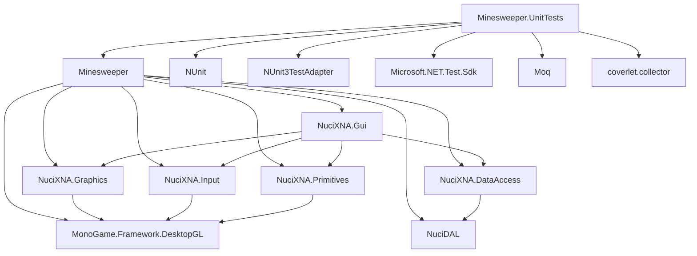

# Dependencies

## NuGet Dependencies

### Minesweeper (Main Project)

| Package | Version | License | Purpose |
|---------|---------|---------|---------|
| `MonoGame.Framework.DesktopGL` | 3.8.4 | MS-PL | Core game framework, graphics, input, audio |
| `NuciXNA.Gui` | 3.2.1 | MIT | Screen management, GUI controls, menu system |
| `NuciXNA.Graphics` | 2.2.3 | MIT | GraphicsManager, primitive drawing |
| `NuciXNA.Input` | 2.0.4 | MIT | InputManager, keyboard/mouse events |
| `NuciXNA.Primitives` | 2.1.6 | MIT | Primitive shape drawing helpers |
| `NuciXNA.DataAccess` | 4.0.3 | MIT | NuciContentManager, Repository<T> base |
| `NuciDAL` | 3.1.0 | MIT | ModelBase, XmlFileObject for XML serialisation |

### Minesweeper.UnitTests

| Package | Version | License | Purpose |
|---------|---------|---------|---------|
| `NUnit` | 4.2.2 | MIT | Test framework |
| `NUnit3TestAdapter` | 4.6.0 | MIT | Visual Studio Test Explorer integration |
| `Microsoft.NET.Test.Sdk` | 17.11.1 | MIT | Test host and discovery |
| `Moq` | 4.20.72 | BSD-3-Clause | Mocking framework (unused) |
| `coverlet.collector` | 6.0.2 | MIT | Code coverage collection |

## Dependency Graph

## NuciXNA Ecosystem

All `NuciXNA.*` and `NuciDAL` packages are from the same author (hmlendea) and designed to work together.

**Version Compatibility Matrix:**
| Package | Depends On |
|---------|------------|
| `NuciXNA.Gui 3.2.1` | `NuciXNA.Graphics 2.2.3`, `NuciXNA.Input 2.0.4`, `NuciXNA.Primitives 2.1.6`, `NuciXNA.DataAccess 4.0.3` |
| `NuciXNA.DataAccess 4.0.3` | `NuciDAL 3.1.0` |
| `NuciXNA.Graphics 2.2.3` | `MonoGame.Framework.DesktopGL 3.8.x` |
| `NuciXNA.Input 2.0.4` | `MonoGame.Framework.DesktopGL 3.8.x` |
| `NuciXNA.Primitives 2.1.6` | `MonoGame.Framework.DesktopGL 3.8.x` |

## MonoGame.Framework.DesktopGL

**Version:** 3.8.4

**Provides:**
- `Microsoft.Xna.Framework.Game` — Base game class
- `GraphicsDeviceManager` — Graphics device lifecycle
- `SpriteBatch` — 2D rendering
- `ContentManager` — Asset loading
- `Input` — Keyboard, Mouse, GamePad states
- `Audio` — SoundEffect, Song (via OpenAL)
- `Math` — Vector2, Matrix, Color, Rectangle

**Platform Backends:**
- Windows: DirectX (via SharpDX) or OpenGL (DesktopGL)
- Linux: OpenGL (via SDL2)
- macOS: OpenGL (via SDL2)

**This Project:** Uses `DesktopGL` variant (OpenGL + SDL2) for cross-platform.

## NuciDAL

**Version:** 3.1.0

**Provides:**
- `ModelBase` — Abstract base with `Id`, `Equals`, `GetHashCode`
- `Repository<T>` — Generic dictionary-based repository with XML persistence
- `XmlFileObject<T>` — XML serialisation helper

**Usage in Project:**
- `Tile : ModelBase`
- `TileRepository : Repository<Tile>`
- `SettingsManager` serialised via `XmlFileObject<SettingsManager>`

## System Dependencies (Runtime)

### Linux (Ubuntu/Debian)

| Package | Purpose |
|---------|---------|
| `libsdl2-2.0-0` | Window management, input (MonoGame backend) |
| `libopenal1` | Audio (MonoGame backend) |
| `libfreetype6` | Font rendering (MonoGame) |
| `ttf-mscorefonts-installer` | Default fonts for SpriteFont rendering |

### Windows

- Bundled: SDL2, OpenAL, FreeType via MonoGame NuGet package

### macOS

| Package | Purpose |
|---------|---------|
| `sdl2` (Homebrew) | Window management, input |

## Transitive Dependencies

Key transitive dependencies (from NuGet lock file):

| Package | Version | Via |
|---------|---------|-----|
| `System.Drawing.Common` | 9.0.0 | MonoGame |
| `System.Text.Json` | 9.0.0 | NuciDAL XML serialisation |
| `Microsoft.Extensions.Logging.Abstractions` | 9.0.0 | NuciXNA logging |
| `SharpDX.Direct3D11` | 4.2.0 | MonoGame (Windows only) |
| `SDL2-CS` | 1.0.0 | MonoGame DesktopGL |

## Dependency Management

**Package Source:** nuget.org

**Version Pinning:** Exact versions specified in `.csproj` files (no floating versions)

**Updates:** Manual; no Dependabot or Renovate configured

**Vulnerability Scanning:** Not configured in CI

## License Compliance

All dependencies use permissive licenses (MIT, MS-PL, BSD-3-Clause). No copyleft licenses detected.

**License Files:** Not included in build output; available via NuGet package metadata.

## Known Issues

1. **Moq Unused:** `Moq 4.20.72` referenced in test project but not used in any test file.

2. **Coverlet Unused:** `coverlet.collector` referenced but no coverage output configured in CI.

3. **NuciXNA Version Lock:** All NuciXNA packages must be updated together to maintain compatibility.

4. **MonoGame 3.8.4:** Not the latest MonoGame version (3.8.5+ exists); upgrade would require testing.