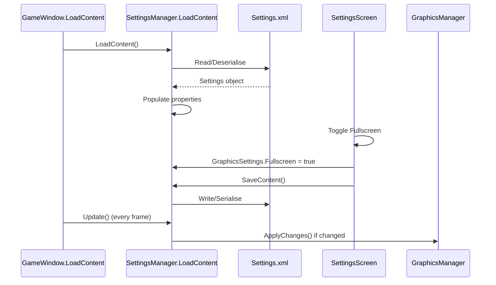

# Settings Configuration

## Overview

Application settings are managed by `SettingsManager` singleton with XML persistence via NuciDAL. Settings cover audio, graphics, and debug preferences.

## SettingsManager

**Location:** `Minesweeper/Settings/SettingsManager.cs`

**Pattern:** Singleton with double-checked locking

**Properties:**

| Property | Type | Default | Description |
|----------|------|---------|-------------|
| `AudioSettings` | `AudioSettings` | `SoundEnabled = true` | Audio preferences |
| `GraphicsSettings` | `GraphicsSettings` | `Fullscreen = false`, `Resolution = 640×700` | Display preferences |
| `DebugMode` | `bool` | `false` | FPS indicator toggle |

## AudioSettings

**Location:** `Minesweeper/Settings/AudioSettings.cs`

```csharp
public class AudioSettings
{
    public bool SoundEnabled { get; set; } = true;
}
```

**Usage:** Currently not connected to any audio system (no sound effects implemented).

## GraphicsSettings

**Location:** `Minesweeper/Settings/GraphicsSettings.cs`

```csharp
public class GraphicsSettings
{
    public bool Fullscreen { get; set; } = false;
    public Size2D Resolution { get; set; } = new Size2D(GameDefines.WindowWidth, GameDefines.WindowHeight);
}
```

**Resolution Behaviour:**
- Windowed: Fixed at `GameDefines.WindowWidth` × `GameDefines.WindowHeight` (640×700)
- Fullscreen: Uses current display mode (queried at apply time)

## SettingsManager Methods

### LoadContent

```csharp
public void LoadContent()
{
    string file = ApplicationPaths.SettingsFile;
    if (File.Exists(file))
    {
        XmlFileObject<SettingsManager> loader = new XmlFileObject<SettingsManager>(file);
        SettingsManager loaded = loader.Load();
        AudioSettings = loaded.AudioSettings;
        GraphicsSettings = loaded.GraphicsSettings;
        DebugMode = loaded.DebugMode;
    }
    else
    {
        // Defaults already set by property initialisers
    }
}
```

### SaveContent

```csharp
public void SaveContent()
{
    XmlFileObject<SettingsManager> saver = new XmlFileObject<SettingsManager>(ApplicationPaths.SettingsFile);
    saver.Save(this);
}
```

### Update (Graphics Application)

```csharp
public void Update()
{
    bool graphicsChanged = false;

    if (GraphicsManager.Instance.Graphics.IsFullScreen != GraphicsSettings.Fullscreen)
    {
        GraphicsManager.Instance.Graphics.IsFullScreen = GraphicsSettings.Fullscreen;
        graphicsChanged = true;
    }

    if (GraphicsManager.Instance.Graphics.PreferredBackBufferWidth != GraphicsSettings.Resolution.Width ||
        GraphicsManager.Instance.Graphics.PreferredBackBufferHeight != GraphicsSettings.Resolution.Height)
    {
        GraphicsManager.Instance.Graphics.PreferredBackBufferWidth = GraphicsSettings.Resolution.Width;
        GraphicsManager.Instance.Graphics.PreferredBackBufferHeight = GraphicsSettings.Resolution.Height;
        graphicsChanged = true;
    }

    if (graphicsChanged)
    {
        GraphicsManager.Instance.Graphics.ApplyChanges();
    }
}
```

**Called:** Every frame in `GameWindow.Update`

## XML Persistence Format

**File:** `ApplicationPaths.SettingsFile` → `%LocalAppData%\Minesweeper\Settings.xml` (Windows) or `~/.local/share/Minesweeper/Settings.xml` (Linux)

**Example Output:**
```xml
<?xml version="1.0" encoding="utf-8"?>
<SettingsManager>
  <AudioSettings>
    <SoundEnabled>true</SoundEnabled>
  </AudioSettings>
  <GraphicsSettings>
    <Fullscreen>false</Fullscreen>
    <Resolution>
      <Width>640</Width>
      <Height>700</Height>
    </Resolution>
  </GraphicsSettings>
  <DebugMode>false</DebugMode>
</SettingsManager>
```

**Serialisation:** `NuciDAL.IO.XmlFileObject<T>` uses standard .NET XML serialisation.

## Settings UI

### SettingsScreen

**Location:** `Minesweeper/Gui/Screens/SettingsScreen.cs`

**Controls:**
- `fullScreenToggle` — `GuiMenuToggle` bound to `GraphicsSettings.Fullscreen`
- `backLink` — Returns to `TitleScreen`

**Event Handling:**
```csharp
fullScreenToggle.StateChanged += (s, e) =>
{
    SettingsManager.Instance.GraphicsSettings.Fullscreen = fullScreenToggle.State;
};
```

**Persistence:** `DoUnloadContent` calls `SettingsManager.Instance.SaveContent()`

## Default Values

| Setting | Default | Configurable |
|---------|---------|--------------|
| `SoundEnabled` | `true` | Yes (UI not connected) |
| `Fullscreen` | `false` | Yes (SettingsScreen) |
| `Resolution.Width` | `640` | No (fixed by GameDefines) |
| `Resolution.Height` | `700` | No (fixed by GameDefines) |
| `DebugMode` | `false` | No (no UI) |

## Known Limitations

1. **Resolution Not User-Configurable:** `GraphicsSettings.Resolution` is initialised from `GameDefines` constants and never exposed in UI.

2. **SoundEnabled Unused:** No audio system implemented; setting persists but has no effect.

3. **DebugMode No UI:** Can only be changed by editing XML directly.

4. **Fullscreen Resolution:** When toggling to fullscreen, `Resolution` is not updated to actual display mode; `Update()` applies fullscreen but keeps windowed resolution values.

5. **No Validation:** XML loading assumes valid structure; corrupted file causes exception.

## Settings Flow

