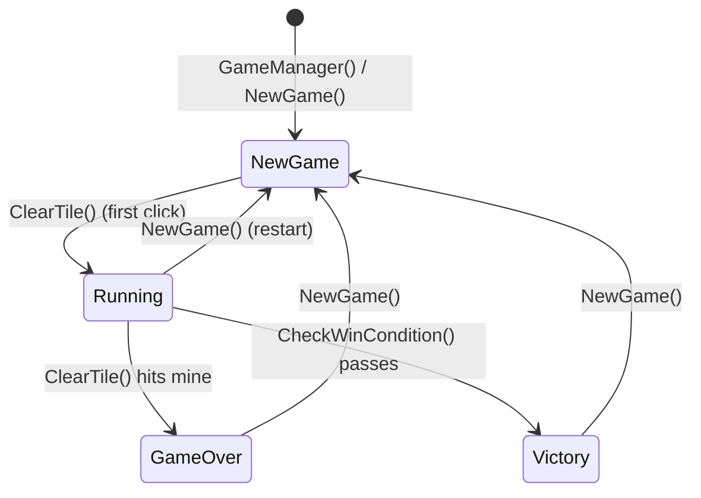
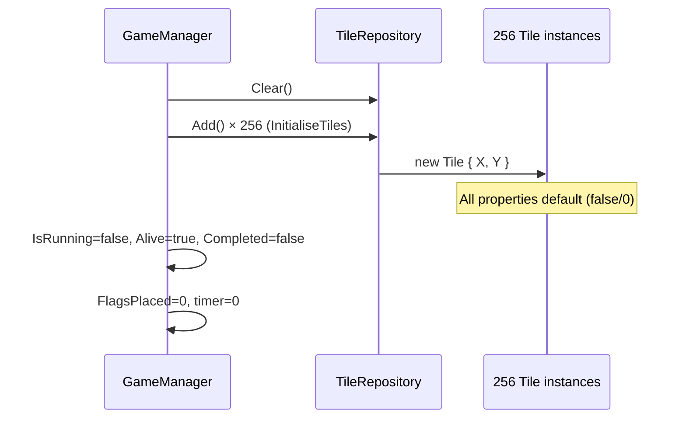

# Game State

## Overview

Game state is distributed across `GameManager` (authoritative), `TileRepository` (tile data), and UI components (derived view state). No central state object exists.

## State Ownership

| State Category | Owner | Persistence |
|----------------|-------|-------------|
| Tile grid (256 tiles) | `TileRepository` | None (recreated each game) |
| Mine placement | `GameManager` (mutates tiles) | None |
| Danger levels | `GameManager` (mutates tiles) | None |
| Game phase (running/win/loss) | `GameManager` (`IsRunning`, `Alive`, `Completed`) | None |
| Flag count | `GameManager` (`FlagsPlaced`) | None |
| Timer | `GameManager` (`timer` field) | None |
| User preferences | `SettingsManager` | XML (`Settings.xml`) |
| High scores | Not implemented | N/A |

## GameManager State Properties

**Location:** `Minesweeper/GameLogic/GameManagers/GameManager.cs`

```csharp
public int TableSize => GameDefines.TableSize;        // 16 (const)
public int MinesCount => GameDefines.MinesCount;      // 24 (const)
public bool IsRunning { get; private set; }           // First clear → true
public bool Alive { get; private set; }               // Mine hit → false
public bool Completed { get; private set; }           // All non-mines cleared → true
public int FlagsLimit => MinesCount;                  // 24
public int FlagsPlaced { get; private set; }          // Current flag count
public int FlagsRemaining => FlagsLimit - FlagsPlaced; // Computed
public string Timer => TimeSpan.FromSeconds(timer).ToString(@"mm\:ss");
```

## State Transitions



### NewGame State (Initial)

| Property | Value |
|----------|-------|
| `IsRunning` | `false` |
| `Alive` | `true` |
| `Completed` | `false` |
| `FlagsPlaced` | `0` |
| `timer` | `0f` |
| All tiles | `Cleared=false`, `Flagged=false`, `Mined=false`, `DangerLevel=0` |

### Running State (After First Clear)

| Property | Value |
|----------|-------|
| `IsRunning` | `true` |
| `Alive` | `true` |
| `Completed` | `false` |
| `FlagsPlaced` | `0..24` |
| `timer` | Incrementing* |
| Mines | Placed (24 tiles, `Mined=true`) |
| DangerLevels | Calculated (0–8) |

*Known bug: `timer` only increments in `GameManager.Update()` which is never called.

### GameOver State (Mine Hit)

| Property | Value |
|----------|-------|
| `IsRunning` | `true` |
| `Alive` | `false` |
| `Completed` | `false` |
| `FlagsPlaced` | Frozen |
| `timer` | Frozen |
| All mines | `Cleared=true` (revealed) |

### Victory State (All Cleared)

| Property | Value |
|----------|-------|
| `IsRunning` | `true` |
| `Alive` | `false` (stops timer) |
| `Completed` | `true` |
| `FlagsPlaced` | Frozen |
| `timer` | Frozen |

## Derived View State

### GuiInfoBar (Reads from GameManager)

| Display | Source |
|---------|--------|
| "Mines: N" | `game.FlagsRemaining` |
| ":)" / ":(" | `game.Alive` |
| "MM:SS" | `game.Timer` |

### GuiGameBoard (Reads from GameManager + Tiles)

| Visual | Condition |
|--------|-----------|
| Number | `tile.Cleared && tile.DangerLevel > 0` |
| Blank revealed | `tile.Cleared && tile.DangerLevel == 0` |
| Flag | `!tile.Cleared && tile.Flagged` |
| Mine (game over) | `!tile.Cleared && !game.Alive && tile.Mined` |
| Covered | `!tile.Cleared && !tile.Flagged` |

## State Initialisation Sequence



## First-Click Mine Placement

**Critical State Mutation:** Mines placed on first `ClearTile` to guarantee first click is safe.

```csharp
// GameManager.ClearTile
if (!IsRunning)
{
    IsRunning = true;
    PlaceMines(x, y);  // Mutates 24 tiles: Mined=true
    CalculateDangerLevels();  // Mutates all non-mine tiles: DangerLevel=0..8
}
```

**PlaceMines Algorithm:**
1. Random positions until 24 mines placed
2. Excludes first-click tile and its 8 neighbours (3×3 area)
3. Sets `tile.Mined = true` on selected tiles

**CalculateDangerLevels Algorithm:**
1. For each non-mine tile, count mined neighbours in 3×3 area
2. Sets `tile.DangerLevel = count`

## Win Condition Evaluation

```csharp
private void CheckWinCondition()
{
    int clearedCount = 0;
    foreach (Tile tile in tileRepository.GetAll())
    {
        if (tile.Cleared) clearedCount++;
    }
    if (clearedCount == TableSize * TableSize - MinesCount)
    {
        Completed = true;
        Alive = false;  // Stops timer
    }
}
```

**Win State:** Exactly 232 tiles cleared (256 - 24 mines)

## Timer State

**Field:** `private float timer;`

**Property:** `public string Timer => TimeSpan.FromSeconds(timer).ToString(@"mm\:ss");`

**Update Logic (Never Executed):**
```csharp
public void Update(GameTime gameTime)
{
    if (IsRunning && Alive && !Completed)
    {
        timer += (float)gameTime.ElapsedGameTime.TotalSeconds;
    }
}
```

**Actual Behaviour:** Timer displays `00:00` throughout gameplay because `GameManager.Update()` is never called by `GameplayScreen`.

**Fix Required:** Call `game.Update(gameTime)` in `GameplayScreen.DoUpdate`.

## Flag State

**Limits:** `FlagsLimit = MinesCount = 24`

**Operations:**
- `FlagTile` on unflagged, uncleared tile → `Flagged=true`, `FlagsPlaced++` (if < limit)
- `FlagTile` on flagged tile → `Flagged=false`, `FlagsPlaced--`
- `FlagTile` on cleared tile → no-op
- `ClearTile` on flagged tile → no-op

**Display:** `FlagsRemaining = FlagsLimit - FlagsPlaced`

## State Reset (NewGame)

```csharp
public void NewGame()
{
    tileRepository.Clear();           // Removes all 256 tiles
    InitialiseTiles();                // Adds 256 fresh tiles
    IsRunning = false;
    Alive = true;
    Completed = false;
    FlagsPlaced = 0;
    timer = 0f;
}
```

**Note:** Creates entirely new `Tile` objects; no object reuse.

## Persistence Gap

**No Game State Persistence:**
- Closing during gameplay loses progress
- No "Continue Game" feature
- Only `SettingsManager` persists (user preferences)

**Required for Save/Load:**
1. Serialise `TileRepository` (via inherited `Save()`)
2. Serialise `GameManager` scalar state (`IsRunning`, `Alive`, `Completed`, `FlagsPlaced`, `timer`)
3. Add "Continue" option to `TitleScreen`
4. Load logic in `GameplayScreen.DoLoadContent`

## Concurrency

**Single-Threaded:** All state mutations occur on the main game loop thread. No locks or atomic operations needed.

**Exception:** `SettingsManager` uses `Lock` for singleton initialisation only.