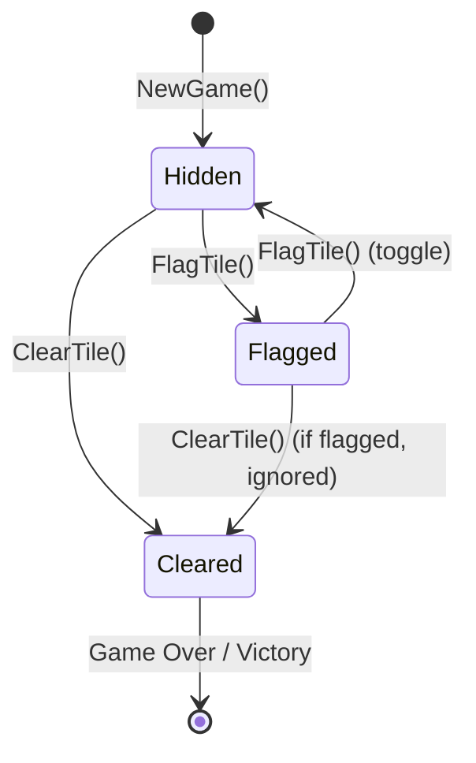

# Tile Entity

## Overview

The `Tile` class is the core domain entity representing a single cell in the minefield. It encapsulates position, state, and mine adjacency information.

## Class Definition

**Location:** `Minesweeper/Models/Tile.cs`

**Inheritance:** `ModelBase` (NuciDAL)

**Namespace:** `Minesweeper.Models`

```csharp
public class Tile : ModelBase
{
    public int X { get; set; }
    public int Y { get; set; }
    public int DangerLevel { get; set; }
    public bool Flagged { get; set; }
    public bool Cleared { get; set; }
    public bool Mined { get; set; }

    public override string Id => $"{X},{Y}";

    public override bool Equals(object obj)
    {
        return obj is Tile other && Id == other.Id;
    }

    public override int GetHashCode()
    {
        return Id.GetHashCode();
    }
}
```

## Properties

| Property | Type | Default | Description |
|----------|------|---------|-------------|
| `X` | `int` | 0 | Column index (0–15) |
| `Y` | `int` | 0 | Row index (0–15) |
| `DangerLevel` | `int` | 0 | Adjacent mine count (0–8) |
| `Flagged` | `bool` | false | Player has placed flag |
| `Cleared` | `bool` | false | Tile has been revealed |
| `Mined` | `bool` | false | Tile contains a mine |
| `Id` | `string` | computed | Composite key `"X,Y"` |

## Identity and Equality

**Id Format:** `"X,Y"` (e.g., `"7,12"`, `"0,0"`, `"15,15"`)

**Equality:** Based solely on `Id` (position). Two tiles at same coordinates are equal regardless of state.

**Hash Code:** `Id.GetHashCode()` — consistent with equality.

**Usage in Repository:** `TileRepository` uses `Id` as dictionary key.

## State Transitions



**Rules:**
- `ClearTile` on `Flagged` tile: No-op (returns early)
- `ClearTile` on `Cleared` tile: No-op
- `FlagTile` on `Cleared` tile: No-op
- `FlagTile` toggles `Flagged` state
- `FlagTile` respects `FlagsLimit` (max 24 flags)

## DangerLevel Semantics

| Value | Meaning | Rendering |
|-------|---------|-----------|
| 0 | No adjacent mines | Blank (triggers flood-fill) |
| 1 | 1 adjacent mine | Blue "1" |
| 2 | 2 adjacent mines | Green "2" |
| 3 | 3 adjacent mines | Red "3" |
| 4 | 4 adjacent mines | Navy "4" |
| 5 | 5 adjacent mines | Maroon "5" |
| 6 | 6 adjacent mines | Purple "6" |
| 7 | 7 adjacent mines | Black "7" |
| 8 | 8 adjacent mines | Gray "8" |

**Calculation:** Performed once in `GameManager.CalculateDangerLevels()` after mine placement. Iterates all 8 neighbours for each non-mine tile.

## ModelBase (NuciDAL)

**Type:** `NuciDAL.Models.ModelBase` (NuciDAL 3.1.0)

**Contract:**
```csharp
public abstract class ModelBase
{
    public abstract string Id { get; }
    public abstract bool Equals(object obj);
    public abstract int GetHashCode();
}
```

**Purpose:** Provides identity contract for `Repository<T>` and XML serialisation via `XmlFileObject<T>`.

## Serialisation

**XML Output Example:**
```xml
<Tile>
  <X>7</X>
  <Y>12</Y>
  <DangerLevel>3</DangerLevel>
  <Flagged>false</Flagged>
  <Cleared>true</Cleared>
  <Mined>false</Mined>
</Tile>
```

**Notes:**
- `Id` is not serialised (computed property)
- All properties are public get/set for XML serialiser
- `ModelBase` enables inclusion in `Repository<T>` collections

## Invariants

1. **Coordinate Bounds:** `0 <= X < 16`, `0 <= Y < 16` (enforced by `GameManager`/`TileRepository`)
2. **DangerLevel Range:** `0 <= DangerLevel <= 8` (enforced by `CalculateDangerLevels`)
3. **Mutual Exclusion:** `Mined` and `Cleared` can both be true (revealed mine at game over)
4. **Flagged Implies Not Cleared:** `Flagged == true` → `Cleared == false` (enforced by `ClearTile`/`FlagTile` logic)
5. **Id Stability:** `Id` never changes after construction (X/Y are set once in `InitialiseTiles`)

## Construction and Initialisation

**Location:** `GameManager.InitialiseTiles()`

```csharp
private void InitialiseTiles()
{
    for (int y = 0; y < TableSize; y++)
    {
        for (int x = 0; x < TableSize; x++)
        {
            Tile tile = new Tile { X = x, Y = y };
            tileRepository.Add(tile);
        }
    }
}
```

**Sequence:**
1. `NewGame()` → `tileRepository.Clear()` → `InitialiseTiles()`
2. All 256 tiles created with `X`, `Y` set; other properties default
3. First `ClearTile` → `PlaceMines()` → `CalculateDangerLevels()`
4. Subsequent `ClearTile`/`FlagTile` mutate existing tiles

## Usage in GameManager

| Operation | Tile Mutation |
|-----------|---------------|
| `ClearTile(x,y)` | `Cleared = true`; if `DangerLevel == 0` → recursive `FloodFillClear` |
| `FlagTile(x,y)` | `Flagged = !Flagged`; `FlagsPlaced++/--` |
| `PlaceMines()` | `Mined = true` for 24 random tiles (excluding first-click neighbourhood) |
| `CalculateDangerLevels()` | `DangerLevel = adjacent mine count` for non-mine tiles |
| `RevealAllMines()` | `Cleared = true` for all `Mined` tiles |
| `NewGame()` | Repository cleared; new tiles created |

## Rendering Mapping (GuiGameBoard)

| Tile State | Rendered As |
|------------|-------------|
| `Cleared && DangerLevel > 0` | Number in `DangerColors[DangerLevel]` |
| `Cleared && DangerLevel == 0` | Blank `revealedColor` background |
| `!Cleared && Flagged` | `flagTexture` on `unrevealedColor` |
| `!Cleared && !Flagged && !Alive && Mined` | `mineTexture` on `unrevealedColor` |
| `!Cleared && !Flagged` | `unrevealedColor` background |

## Unit Test Coverage

**Location:** `Minesweeper.UnitTests/Models/TileTests.cs`

**Test Cases:**
- `Id_ReturnsCorrectFormat` — `"X,Y"` format
- `Equals_SameCoordinates_ReturnsTrue` — position-based equality
- `Equals_DifferentCoordinates_ReturnsFalse`
- `GetHashCode_ConsistentWithEquals`
- `DefaultValues_AreCorrect` — all bool false, int 0
- `PropertyAssignment_Works` — setters functional