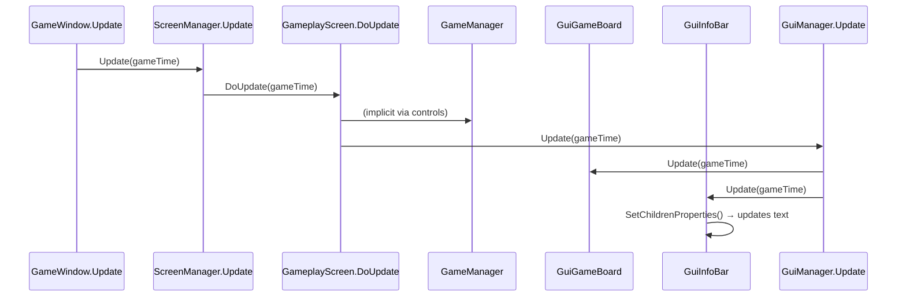
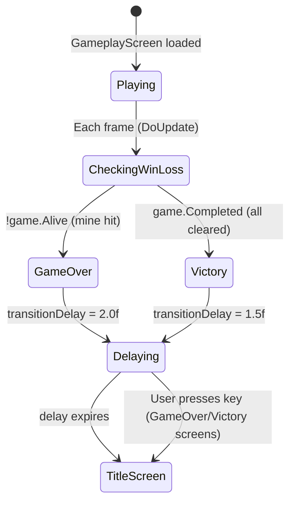

# Gameplay Loop

## Overview

The gameplay loop runs within `GameplayScreen` and coordinates the `GameManager`, `GuiGameBoard`, and `GuiInfoBar` through the NuciXNA screen and GUI managers.

## GameplayScreen Update Flow



## GameplayScreen.DoUpdate

**Location:** `Minesweeper/Gui/Screens/GameplayScreen.cs`

```csharp
protected override void DoUpdate(GameTime gameTime)
{
    if (transitionScheduled)
    {
        transitionDelay -= (float)gameTime.ElapsedGameTime.TotalSeconds;
        if (transitionDelay <= 0)
        {
            ScreenManager.Instance.ChangeScreens<TitleScreen>();
        }
        return;
    }

    // Check win/loss conditions
    if (!game.Alive)
    {
        transitionScheduled = true;
        transitionDelay = 2.0f;  // Game over delay
    }
    else if (game.Completed)
    {
        transitionScheduled = true;
        transitionDelay = 1.5f;  // Victory delay
    }
}
```

**Key Points:**
- Does NOT call `game.Update()` — `GameManager` is stateless between input events
- Win/loss detection is polled each frame via `game.Alive` and `game.Completed`
- Transitions use delays to show final board state

## GameManager State Machine

**Location:** `Minesweeper/GameLogic/GameManagers/GameManager.cs`

### State Properties

| Property | Type | Description |
|----------|------|-------------|
| `IsRunning` | `bool` | True after first clear, false after win/loss |
| `Alive` | `bool` | False when mine cleared |
| `Completed` | `bool` | True when all non-mine tiles cleared |
| `FlagsPlaced` | `int` | Current flag count |
| `FlagsRemaining` | `int` | `MinesCount - FlagsPlaced` |
| `FlagsLimit` | `int` | `MinesCount` (max flags) |

### Timer

```csharp
private float timer;
public string Timer => TimeSpan.FromSeconds(timer).ToString(@"mm\:ss");

public void Update(GameTime gameTime)
{
    if (IsRunning && Alive && !Completed)
    {
        timer += (float)gameTime.ElapsedGameTime.TotalSeconds;
    }
}
```

**Note:** `GameManager.Update()` is NOT called by `GameplayScreen`. The timer update is effectively dead code in current implementation. Timer only updates if `GameplayScreen` called it (it doesn't).

## Input Handling Flow

### Mouse Input

**Location:** `GameplayScreen.OnMouseButtonPressed`

```csharp
private void OnMouseButtonPressed(object sender, MouseButtonEventArgs e)
{
    if (e.Button != MouseButton.Left && e.Button != MouseButton.Right) return;

    Point mousePos = e.Position;
    int boardX = mousePos.X;
    int boardY = mousePos.Y - GameDefines.InfoBarHeight;  // Adjust for info bar

    if (boardX < 0 || boardX >= GameDefines.BoardWidth ||
        boardY < 0 || boardY >= GameDefines.BoardHeight) return;

    int tileX = boardX / GameDefines.MapTileSize;
    int tileY = boardY / GameDefines.MapTileSize;

    if (e.Button == MouseButton.Left)
    {
        game.ClearTile(tileX, tileY);
    }
    else
    {
        game.FlagTile(tileX, tileY);
    }
}
```

### Keyboard Input

**Location:** `GameplayScreen.OnKeyboardKeyPressed`

```csharp
private void OnKeyboardKeyPressed(object sender, KeyboardKeyEventArgs e)
{
    switch (e.Key)
    {
        case Keys.N:
        case Keys.R:
            RestartGame();
            break;
        case Keys.Escape:
            ScreenManager.Instance.ChangeScreens<TitleScreen>();
            break;
    }
}

private void RestartGame()
{
    game.NewGame();
    transitionScheduled = false;
}
```

## GameManager Operations

### ClearTile

**Location:** `GameManager.ClearTile(int x, int y)`

```csharp
public void ClearTile(int x, int y)
{
    Tile tile = tileRepository.Get(x, y);
    if (tile is null || tile.Cleared || tile.Flagged) return;

    if (!IsRunning)
    {
        IsRunning = true;
        PlaceMines(x, y);  // First click: place mines avoiding this tile
    }

    tile.Cleared = true;

    if (tile.Mined)
    {
        Alive = false;
        RevealAllMines();
        return;
    }

    if (tile.DangerLevel == 0)
    {
        FloodFillClear(x, y);  // Recursive clear of adjacent zeros
    }

    CheckWinCondition();
}
```

### PlaceMines (First Click Safety)

```csharp
private void PlaceMines(int safeX, int safeY)
{
    Random random = new Random();
    int placed = 0;

    while (placed < GameDefines.MinesCount)
    {
        int x = random.Next(GameDefines.TableSize);
        int y = random.Next(GameDefines.TableSize);

        // Skip first-click tile and its 8 neighbours
        if (Math.Abs(x - safeX) <= 1 && Math.Abs(y - safeY) <= 1) continue;

        Tile tile = tileRepository.Get(x, y);
        if (tile is null || tile.Mined) continue;

        tile.Mined = true;
        placed++;
    }

    CalculateDangerLevels();
}
```

### CalculateDangerLevels

```csharp
private void CalculateDangerLevels()
{
    for (int y = 0; y < TableSize; y++)
    {
        for (int x = 0; x < TableSize; x++)
        {
            Tile tile = tileRepository.Get(x, y);
            if (tile is null || tile.Mined) continue;

            int count = 0;
            for (int dy = -1; dy <= 1; dy++)
            {
                for (int dx = -1; dx <= 1; dx++)
                {
                    if (dx == 0 && dy == 0) continue;
                    Tile neighbour = tileRepository.Get(x + dx, y + dy);
                    if (neighbour?.Mined == true) count++;
                }
            }
            tile.DangerLevel = count;
        }
    }
}
```

### FloodFillClear (Recursive)

```csharp
private void FloodFillClear(int x, int y)
{
    for (int dy = -1; dy <= 1; dy++)
    {
        for (int dx = -1; dx <= 1; dx++)
        {
            if (dx == 0 && dy == 0) continue;
            int nx = x + dx;
            int ny = y + dy;

            Tile neighbour = tileRepository.Get(nx, ny);
            if (neighbour is null || neighbour.Cleared || neighbour.Flagged) continue;

            neighbour.Cleared = true;

            if (neighbour.DangerLevel == 0 && !neighbour.Mined)
            {
                FloodFillClear(nx, ny);  // Recursive
            }
        }
    }
}
```

### FlagTile

```csharp
public void FlagTile(int x, int y)
{
    Tile tile = tileRepository.Get(x, y);
    if (tile is null || tile.Cleared) return;

    if (tile.Flagged)
    {
        tile.Flagged = false;
        FlagsPlaced--;
    }
    else if (FlagsPlaced < FlagsLimit)
    {
        tile.Flagged = true;
        FlagsPlaced++;
    }
}
```

### CheckWinCondition

```csharp
private void CheckWinCondition()
{
    int clearedCount = 0;
    foreach (Tile tile in tileRepository.GetAll())
    {
        if (tile.Cleared) clearedCount++;
    }

    if (clearedCount == TableSize * TableSize - MinesCount)
    {
        Completed = true;
        Alive = false;  // Stops timer
    }
}
```

### RevealAllMines (Game Over)

```csharp
private void RevealAllMines()
{
    foreach (Tile tile in tileRepository.GetAll())
    {
        if (tile.Mined)
        {
            tile.Cleared = true;
        }
    }
}
```

### NewGame (Reset)

```csharp
public void NewGame()
{
    tileRepository.Clear();
    InitialiseTiles();
    IsRunning = false;
    Alive = true;
    Completed = false;
    FlagsPlaced = 0;
    timer = 0f;
}
```

## TileRepository Operations

**Location:** `Minesweeper/Repositories/TileRepository.cs`

### Get(x, y)

```csharp
public Tile Get(int x, int y)
{
    string key = $"{x},{y}";
    return base.Get(key);
}
```

### GetAll()

```csharp
public IEnumerable<Tile> GetAll()
{
    return base.GetAll();
}
```

### Clear()

```csharp
public void Clear()
{
    base.Clear();
}
```

**Base Repository (NuciDAL):**
- Uses `Dictionary<string, T>` internally
- Key format: `"X,Y"` (e.g., `"7,12"`)
- XML serialisable via `NuciDAL.IO.XmlFileObject`

## GuiGameBoard Rendering Loop

**Location:** `Minesweeper/Gui/Controls/GuiGameBoard.cs`

### DoDraw (Called by GuiManager.Draw)

```csharp
public override void DoDraw(SpriteBatch spriteBatch)
{
    int tableSize = game.TableSize;
    int tileSize = GameDefines.MapTileSize;
    int originX = 0;
    int originY = GameDefines.InfoBarHeight;

    for (int y = 0; y < tableSize; y++)
    {
        for (int x = 0; x < tableSize; x++)
        {
            Tile tile = game.GetTile(x, y);
            int px = originX + x * tileSize;
            int py = originY + y * tileSize;
            Rectangle destRect = new Rectangle(px, py, tileSize - 1, tileSize - 1);

            if (tile.Cleared)
            {
                spriteBatch.Draw(pixelTexture, destRect, revealedColor);
                if (tile.DangerLevel > 0)
                {
                    string text = tile.DangerLevel.ToString();
                    Vector2 textSize = dangerFont.MeasureString(text);
                    Vector2 textPos = new Vector2(
                        px + (tileSize - textSize.X) / 2,
                        py + (tileSize - textSize.Y) / 2);
                    spriteBatch.DrawString(dangerFont, text, textPos, DangerColors[tile.DangerLevel]);
                }
            }
            else
            {
                spriteBatch.Draw(pixelTexture, destRect, unrevealedColor);
                if (tile.Flagged)
                {
                    spriteBatch.Draw(flagTexture, destRect, Color.White);
                }
                else if (!game.Alive && tile.Mined)
                {
                    spriteBatch.Draw(mineTexture, destRect, Color.White);
                }
            }

            // Grid lines
            spriteBatch.Draw(pixelTexture, new Rectangle(px, py, 1, tileSize), gridLineColor);
            spriteBatch.Draw(pixelTexture, new Rectangle(px, py, tileSize, 1), gridLineColor);
        }
    }
}
```

## GuiInfoBar Update Loop

**Location:** `Minesweeper/Gui/Controls/GuiInfoBar.cs`

### DoUpdate

```csharp
public override void DoUpdate(GameTime gameTime)
{
    flagsText.Text = $"Mines: {game.FlagsRemaining}";
    faceText.Text = game.Alive ? ":)" : ":(";
    timerText.Text = game.Timer;  // Uses GameManager.Timer property
    SetChildrenProperties();
}
```

### SetChildrenProperties

```csharp
protected override void SetChildrenProperties()
{
    int third = Size.Width / 3;
    flagsText.Position = new Vector2(0, 0);
    faceText.Position = new Vector2(third + (third - faceText.Size.Width) / 2, 0);
    timerText.Position = new Vector2(2 * third + (third - timerText.Size.Width) / 2, 0);
}
```

## Game Loop Timing

| Component | Update Frequency | Trigger |
|-----------|------------------|---------|
| `GameWindow.Update` | 60 Hz (vsync) | MonoGame loop |
| `ScreenManager.Update` | 60 Hz | GameWindow |
| `GameplayScreen.DoUpdate` | 60 Hz | ScreenManager |
| `GuiManager.Update` | 60 Hz | ScreenManager |
| `GuiGameBoard.Update` | 60 Hz | GuiManager |
| `GuiInfoBar.Update` | 60 Hz | GuiManager |
| `GameManager.Update` | Never* | Not called |
| `InputManager.Update` | 60 Hz | GameWindow (if active) |

*Known issue: `GameManager.Update()` is never called, so timer only updates when `GuiInfoBar` reads `game.Timer` property (which computes from `timer` field). The `timer` field is only incremented in `GameManager.Update()`, creating a bug where the timer doesn't advance during gameplay.

## Win/Loss Transition Flow

