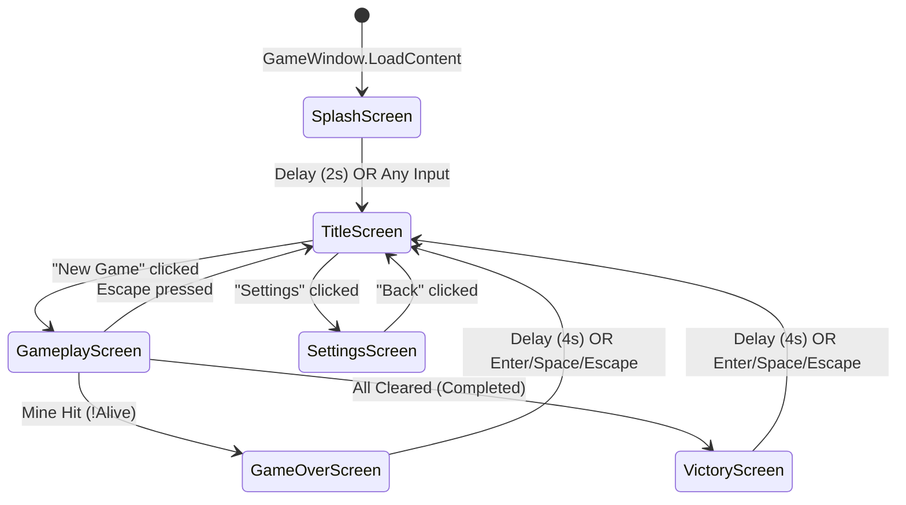

# Screen Transitions

## Overview

Screen transitions are managed by NuciXNA's `ScreenManager` using generic `ChangeScreens<T>()` method. The application follows a linear flow with conditional branches for game outcomes.

## Screen Flow Diagram



## ScreenManager.ChangeScreens<T>

**Type:** `NuciXNA.Gui.Screens.ScreenManager`

**Behaviour:**
1. Unloads current screen (`DoUnloadContent`, `UnregisterEvents`)
2. Creates new screen instance of type `T`
3. Loads new screen (`DoLoadContent`, `RegisterEvents`)
4. Sets as active screen

**Thread Safety:** Single-threaded; called from `Update` loop only.

## Transition Details

### SplashScreen → TitleScreen

**Trigger:** `SplashScreen.DoUpdate`

```csharp
protected override void DoUpdate(GameTime gameTime)
{
    delay -= (float)gameTime.ElapsedGameTime.TotalSeconds;
    if (delay <= 0 || InputManager.Instance.AnyKeyPressed || InputManager.Instance.AnyMouseButtonPressed)
    {
        ScreenManager.Instance.ChangeScreens<TitleScreen>();
    }
}
```

**Delay:** 2 seconds (configurable via `Delay` property)

**Input Override:** Any keyboard key or mouse button skips delay

### TitleScreen → GameplayScreen

**Trigger:** `TitleScreen` menu link click

**Implementation:** `MenuScreen` (NuciXNA) handles link clicks via `GuiMenuLink.Clicked` event

```csharp
// TitleScreen constructor
newGameLink = new GuiMenuLink("New Game");
newGameLink.Clicked += (s, e) => ScreenManager.Instance.ChangeScreens<GameplayScreen>();
```

### TitleScreen → SettingsScreen

**Trigger:** Settings menu link click

```csharp
settingsLink = new GuiMenuLink("Settings");
settingsLink.Clicked += (s, e) => ScreenManager.Instance.ChangeScreens<SettingsScreen>();
```

### SettingsScreen → TitleScreen

**Trigger:** Back link click

```csharp
backLink = new GuiMenuLink("Back");
backLink.Clicked += (s, e) => ScreenManager.Instance.ChangeScreens<TitleScreen>();
```

**Side Effect:** `SettingsScreen.DoUnloadContent` saves settings

```csharp
protected override void DoUnloadContent()
{
    SettingsManager.Instance.SaveContent();
    base.DoUnloadContent();
}
```

### GameplayScreen → GameOverScreen

**Trigger:** `GameplayScreen.DoUpdate` detects `!game.Alive`

```csharp
protected override void DoUpdate(GameTime gameTime)
{
    if (!game.Alive)
    {
        transitionScheduled = true;
        transitionDelay = 2.0f;  // Show final board for 2 seconds
    }
    // ...
}
```

**Delay:** 2 seconds before transition

**Transition Execution:**
```csharp
if (transitionScheduled)
{
    transitionDelay -= (float)gameTime.ElapsedGameTime.TotalSeconds;
    if (transitionDelay <= 0)
    {
        ScreenManager.Instance.ChangeScreens<GameOverScreen>();
    }
    return;
}
```

### GameplayScreen → VictoryScreen

**Trigger:** `GameplayScreen.DoUpdate` detects `game.Completed`

```csharp
else if (game.Completed)
{
    transitionScheduled = true;
    transitionDelay = 1.5f;  // Show victory for 1.5 seconds
}
```

**Delay:** 1.5 seconds before transition

### GameplayScreen → TitleScreen (Escape)

**Trigger:** Escape key in `GameplayScreen.OnKeyboardKeyPressed`

```csharp
case Keys.Escape:
    ScreenManager.Instance.ChangeScreens<TitleScreen>();
    break;
```

**Side Effect:** `GameplayScreen.DoUnloadContent` saves settings and unloads game

```csharp
protected override void DoUnloadContent()
{
    game.UnloadContent();
    UnregisterEvents();
    SettingsManager.Instance.SaveContent();
    base.DoUnloadContent();
}
```

### GameOverScreen → TitleScreen

**Trigger:** Auto-delay or user input

```csharp
protected override void DoUpdate(GameTime gameTime)
{
    delay -= (float)gameTime.ElapsedGameTime.TotalSeconds;
    if (delay <= 0 || InputManager.Instance.IsKeyPressed(Keys.Enter) ||
        InputManager.Instance.IsKeyPressed(Keys.Space) ||
        InputManager.Instance.IsKeyPressed(Keys.Escape))
    {
        ScreenManager.Instance.ChangeScreens<TitleScreen>();
    }
}
```

**Delay:** 4 seconds (configurable via `delay` field)

**Input Override:** Enter, Space, or Escape

### VictoryScreen → TitleScreen

**Identical to GameOverScreen** — same delay and input handling

## Screen Lifecycle Events

### DoLoadContent (Screen)

Called when screen becomes active. Typical pattern:

```csharp
protected override void DoLoadContent()
{
    // 1. Create controls
    // 2. Register controls with GuiManager
    // 3. Register input events
    // 4. Set initial layout
    RegisterEvents();
    SetChildrenProperties();
}
```

### DoUnloadContent (Screen)

Called when screen is being replaced. Typical pattern:

```csharp
protected override void DoUnloadContent()
{
    // 1. Unload owned resources
    // 2. Unregister input events
    // 3. Save state if needed
    UnregisterEvents();
    base.DoUnloadContent();
}
```

### RegisterEvents / UnregisterEvents

**Base Screen (NuciXNA):**

```csharp
protected virtual void RegisterEvents()
{
    InputManager.Instance.KeyboardKeyPressed += OnKeyboardKeyPressed;
    InputManager.Instance.MouseButtonPressed += OnMouseButtonPressed;
}

protected virtual void UnregisterEvents()
{
    InputManager.Instance.KeyboardKeyPressed -= OnKeyboardKeyPressed;
    InputManager.Instance.MouseButtonPressed -= OnMouseButtonPressed;
}
```

**Critical:** Every `+=` must have matching `-=` to prevent memory leaks and duplicate event firing.

## Screen-Specific Event Handlers

| Screen | Keyboard Events | Mouse Events |
|--------|-----------------|--------------|
| SplashScreen | Any key → Title | Any click → Title |
| TitleScreen | Menu navigation (NuciXNA) | Menu clicks (NuciXNA) |
| GameplayScreen | N/R → Restart, Escape → Title | Left → Clear, Right → Flag |
| SettingsScreen | Menu navigation | Menu clicks |
| GameOverScreen | Enter/Space/Escape → Title | None |
| VictoryScreen | Enter/Space/Escape → Title | None |

## Transition Timing Summary

| Transition | Delay | Input Override |
|------------|-------|----------------|
| Splash → Title | 2.0s | Any key/click |
| Gameplay → GameOver | 2.0s | None (auto) |
| Gameplay → Victory | 1.5s | None (auto) |
| GameOver → Title | 4.0s | Enter/Space/Escape |
| Victory → Title | 4.0s | Enter/Space/Escape |
| Gameplay → Title (Esc) | 0s | Immediate |
| Title → Gameplay | 0s | Click |
| Title → Settings | 0s | Click |
| Settings → Title | 0s | Click |

## Screen State Preservation

**No State Preservation:** Each screen transition creates a new instance. State is not preserved between visits.

**Exceptions:**
- `SettingsManager` (singleton) persists across all screens
- `GameManager` is recreated on each `GameplayScreen` visit (via `NewGame()` in `RestartGame()`)
- `TileRepository` is cleared and reinitialised on `NewGame()`

## Known Issues

1. **GameplayScreen Escape Transition:** Does not call `game.NewGame()` before transitioning, so returning to gameplay starts a fresh game (correct behaviour).

2. **SettingsScreen Fullscreen Toggle:** Changes `GraphicsSettings.Fullscreen` immediately but `SettingsManager.Update()` (called in `GameWindow.Update`) applies it on next frame. No visual feedback during transition.

3. **Double Transition Risk:** If user presses Escape during GameOver/GameOver delay, could trigger two transitions. Mitigated by `transitionScheduled` flag in `GameplayScreen` but not in end-game screens.