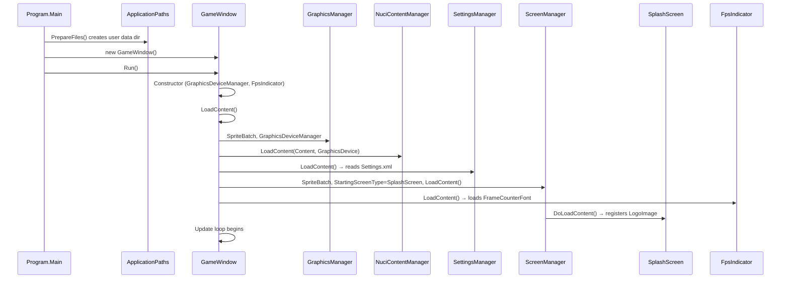
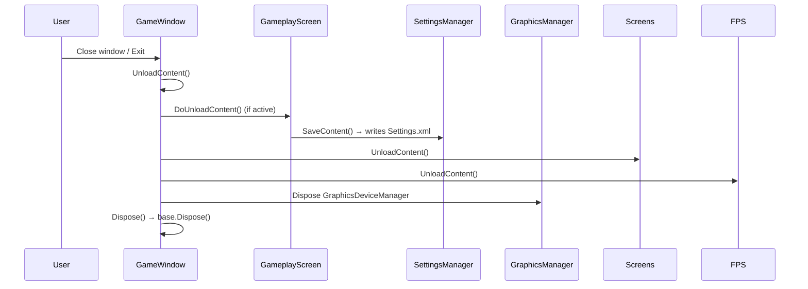

# Startup and Rendering Flow

## Application Startup Sequence



## Detailed Startup Steps

### 1. Program.Main (Entry Point)

**Location:** `Minesweeper/Program.cs`

```csharp
[STAThread]
static void Main()
{
    PrepareFiles();  // Creates user data directory
    RunGame();       // Creates and runs GameWindow
}
```

**PrepareFiles:**
- Calls `Directory.CreateDirectory(ApplicationPaths.UserDataDirectory)`
- Ensures `%LocalAppData%\Minesweeper\` (Windows) or `~/.local/share/Minesweeper/` (Linux) exists

### 2. GameWindow Construction

**Location:** `Minesweeper/GameWindow.cs`

```csharp
public GameWindow()
{
    graphics = new GraphicsDeviceManager(this)
    {
        PreferredDepthStencilFormat = DepthFormat.Depth24Stencil8,
        PreferredBackBufferWidth = GameDefines.WindowWidth,   // 640
        PreferredBackBufferHeight = GameDefines.WindowHeight  // 700
    };
    Content.RootDirectory = "Content";
    IsMouseVisible = true;
    fpsIndicator = new FpsIndicator();
}
```

### 3. GameWindow.LoadContent

**Order of Initialisation:**

1. **SpriteBatch Creation**
   ```csharp
   spriteBatch = new SpriteBatch(GraphicsDevice);
   ```

2. **GraphicsManager (NuciXNA)**
   ```csharp
   GraphicsManager.Instance.SpriteBatch = spriteBatch;
   GraphicsManager.Instance.Graphics = graphics;
   ```

3. **NuciContentManager (NuciXNA)**
   ```csharp
   NuciContentManager.Instance.LoadContent(Content, GraphicsDevice);
   ```
   - Loads all compiled `.xnb` assets from `Content/bin/DesktopGL/Content/`

4. **SettingsManager (Application)**
   ```csharp
   SettingsManager.Instance.LoadContent();
   ```
   - Reads `Settings.xml` or creates defaults
   - Populates `AudioSettings`, `GraphicsSettings`, `DebugMode`

5. **ScreenManager (NuciXNA)**
   ```csharp
   ScreenManager.Instance.SpriteBatch = spriteBatch;
   ScreenManager.Instance.StartingScreenType = typeof(SplashScreen);
   ScreenManager.Instance.LoadContent();
   ```
   - Triggers `SplashScreen.DoLoadContent()`

6. **FpsIndicator (Application)**
   ```csharp
   fpsIndicator.LoadContent();
   ```
   - Loads `Fonts/FrameCounterFont`

### 4. SplashScreen.DoLoadContent

**Location:** `Minesweeper/Gui/Screens/SplashScreen.cs`

```csharp
protected override void DoLoadContent()
{
    LogoImage = new GuiImage { ContentFile = "SplashScreen/Logo" };
    GuiManager.Instance.RegisterControls(LogoImage);
    RegisterEvents();  // Keyboard + Mouse input
    SetChildrenProperties();  // Centres logo
}
```

## Main Game Loop

### Update Loop (GameWindow.Update)

```csharp
protected override void Update(GameTime gameTime)
{
    SettingsManager.Instance.Update();           // Apply graphics changes
    ScreenManager.Instance.Update(gameTime);     // Update active screen

    if (IsActive)
    {
        InputManager.Instance.Update(Window);    // Poll input
    }
    else
    {
        InputManager.Instance.ResetInputStates(); // Clear input when unfocused
    }

    fpsIndicator.Update(gameTime);               // Update FPS counter
    base.Update(gameTime);
}
```

### Draw Loop (GameWindow.Draw)

```csharp
protected override void Draw(GameTime gameTime)
{
    graphics.GraphicsDevice.Clear(Color.Black);

    spriteBatch.Begin();

    ScreenManager.Instance.Draw(spriteBatch);    // Draw active screen + controls
    fpsIndicator.Draw(spriteBatch);              // Draw FPS if DebugMode

    spriteBatch.End();

    base.Draw(gameTime);
}
```

## Screen Update/Draw Flow

### ScreenManager.Update → ActiveScreen.DoUpdate

```csharp
// ScreenManager (NuciXNA)
public void Update(GameTime gameTime)
{
    activeScreen?.DoUpdate(gameTime);
    GuiManager.Instance.Update(gameTime);  // Update registered controls
}
```

### ScreenManager.Draw → ActiveScreen.DoDraw + Controls

```csharp
// ScreenManager (NuciXNA)
public void Draw(SpriteBatch spriteBatch)
{
    activeScreen?.DoDraw(spriteBatch);
    GuiManager.Instance.Draw(spriteBatch);  // Draw registered controls
}
```

## Rendering Pipeline

### Per-Frame Rendering Order

1. `GraphicsDevice.Clear(Color.Black)`
2. `SpriteBatch.Begin()`
3. **ScreenManager.Draw** → Active screen's `DoDraw` (usually empty)
4. **GuiManager.Draw** → All registered controls' `Draw`:
   - `GuiGameBoard` → Tile grid, numbers, flags, mines
   - `GuiInfoBar` → Timer, mine count, face
   - `GuiMenuLink`/`GuiMenuToggle` (menu screens)
   - `GuiImage` (splash screen)
   - `GuiText` (game over/victory screens)
5. **FpsIndicator.Draw** (if `DebugMode`)
6. `SpriteBatch.End()`

### GuiGameBoard Drawing Detail

**Location:** `Minesweeper/Gui/Controls/GuiGameBoard.cs`

```csharp
for (int y = 0; y < tableSize; y++)
{
    for (int x = 0; x < tableSize; x++)
    {
        Tile tile = game.GetTile(x, y);
        int px = originX + x * tileSize;
        int py = originY + y * tileSize;
        Rectangle destRect = new Rectangle(px, py, tileSize - 1, tileSize - 1);

        if (tile.Cleared)
        {
            spriteBatch.Draw(pixelTexture, destRect, revealedColor);
            if (tile.DangerLevel > 0)
            {
                // Draw danger number
            }
        }
        else
        {
            spriteBatch.Draw(pixelTexture, destRect, unrevealedColor);
            if (tile.Flagged) spriteBatch.Draw(flagTexture, ...);
            else if (!game.Alive && tile.Mined) spriteBatch.Draw(mineTexture, ...);
        }
        // Draw grid lines
    }
}
```

## Content Loading Flow

### Build-Time (MonoGame Content Builder)

1. `Content.mgcb` defines assets
2. `MonoGame.Content.Builder.Task` compiles at build
3. Output: `Content/bin/DesktopGL/Content/` with `.xnb` files

### Runtime (NuciContentManager)

1. `GameWindow.LoadContent` → `NuciContentManager.Instance.LoadContent(Content, GraphicsDevice)`
2. Controls call in `DoLoadContent`:
   - `NuciContentManager.Instance.LoadTexture2D("Tiles/mine")`
   - `NuciContentManager.Instance.LoadSpriteFont("Fonts/InfoBarFont")`
3. Assets cached for process lifetime

## Shutdown Flow



**Settings Persistence:**
- Only saved on clean `GameplayScreen` or `SettingsScreen` unload
- Abrupt termination loses unsaved preferences