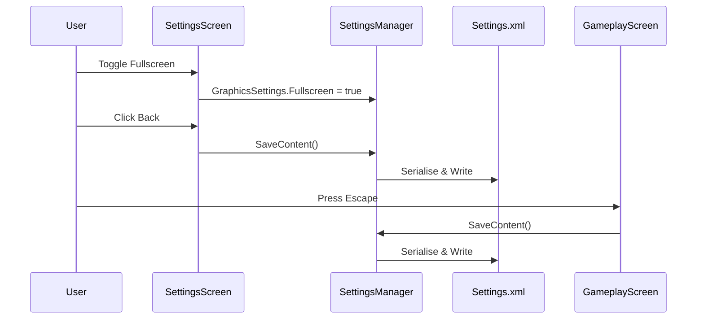

# Settings Persistence

## Overview

User preferences are persisted via `SettingsManager` singleton using XML serialisation through NuciDAL's `XmlFileObject<T>`.

## SettingsManager Persistence

**Location:** `Minesweeper/Settings/SettingsManager.cs`

### File Location

**Path:** `ApplicationPaths.SettingsFile`
- Windows: `%LocalAppData%\Minesweeper\Settings.xml`
- Linux: `~/.local/share/Minesweeper/Settings.xml`

### Serialisation Format

```xml
<?xml version="1.0" encoding="utf-8"?>
<SettingsManager>
  <AudioSettings>
    <SoundEnabled>true</SoundEnabled>
  </AudioSettings>
  <GraphicsSettings>
    <Fullscreen>false</Fullscreen>
    <Resolution>
      <Width>640</Width>
      <Height>700</Height>
    </Resolution>
  </GraphicsSettings>
  <DebugMode>false</DebugMode>
</SettingsManager>
```

### LoadContent

```csharp
public void LoadContent()
{
    string file = ApplicationPaths.SettingsFile;
    if (File.Exists(file))
    {
        XmlFileObject<SettingsManager> loader = new XmlFileObject<SettingsManager>(file);
        SettingsManager loaded = loader.Load();
        AudioSettings = loaded.AudioSettings;
        GraphicsSettings = loaded.GraphicsSettings;
        DebugMode = loaded.DebugMode;
    }
    // Else: defaults from property initialisers
}
```

**Called:** Once in `GameWindow.LoadContent`

### SaveContent

```csharp
public void SaveContent()
{
    XmlFileObject<SettingsManager> saver = new XmlFileObject<SettingsManager>(ApplicationPaths.SettingsFile);
    saver.Save(this);
}
```

**Called:**
- `GameplayScreen.DoUnloadContent` (on game exit, win, loss, or escape to title)
- `SettingsScreen.DoUnloadContent` (on back to title)

### Update (Runtime Application)

```csharp
public void Update()
{
    bool graphicsChanged = false;

    if (GraphicsManager.Instance.Graphics.IsFullScreen != GraphicsSettings.Fullscreen)
    {
        GraphicsManager.Instance.Graphics.IsFullScreen = GraphicsSettings.Fullscreen;
        graphicsChanged = true;
    }

    if (GraphicsManager.Instance.Graphics.PreferredBackBufferWidth != GraphicsSettings.Resolution.Width ||
        GraphicsManager.Instance.Graphics.PreferredBackBufferHeight != GraphicsSettings.Resolution.Height)
    {
        GraphicsManager.Instance.Graphics.PreferredBackBufferWidth = GraphicsSettings.Resolution.Width;
        GraphicsManager.Instance.Graphics.PreferredBackBufferHeight = GraphicsSettings.Resolution.Height;
        graphicsChanged = true;
    }

    if (graphicsChanged)
    {
        GraphicsManager.Instance.Graphics.ApplyChanges();
    }
}
```

**Called:** Every frame in `GameWindow.Update`

## Persisted Settings

| Setting | Type | Default | UI Control |
|---------|------|---------|------------|
| `AudioSettings.SoundEnabled` | `bool` | `true` | None (unused) |
| `GraphicsSettings.Fullscreen` | `bool` | `false` | SettingsScreen toggle |
| `GraphicsSettings.Resolution` | `Size2D` | `640×700` | None (fixed) |
| `DebugMode` | `bool` | `false` | None (no UI) |

## Persistence Triggers



## Known Issues

1. **No Error Handling:** `LoadContent`/`SaveContent` can throw `XmlException`, `IOException`, `UnauthorizedAccessException` — all uncaught.

2. **Resolution Not Persisted Correctly:** `Resolution` property is initialised from `GameDefines` constants but never updated when fullscreen changes. The `Update()` method applies fullscreen but doesn't update the `Resolution` property to match actual display mode.

3. **DebugMode Not Exposed:** No UI to toggle; must edit XML manually.

4. **SoundEnabled Unused:** No audio system implemented.

5. **No Migration:** Schema changes would break loading.

## Recommended Improvements

### Robust LoadContent

```csharp
public void LoadContent()
{
    string file = ApplicationPaths.SettingsFile;
    try
    {
        if (File.Exists(file))
        {
            XmlFileObject<SettingsManager> loader = new XmlFileObject<SettingsManager>(file);
            SettingsManager loaded = loader.Load();
            AudioSettings = loaded.AudioSettings;
            GraphicsSettings = loaded.GraphicsSettings;
            DebugMode = loaded.DebugMode;
        }
    }
    catch (XmlException ex)
    {
        Debug.WriteLine($"Settings XML corrupt, using defaults: {ex.Message}");
        File.Delete(file);  // Remove corrupt file
    }
    catch (IOException ex)
    {
        Debug.WriteLine($"Settings load failed, using defaults: {ex.Message}");
    }
}
```

### Robust SaveContent

```csharp
public void SaveContent()
{
    try
    {
        XmlFileObject<SettingsManager> saver = new XmlFileObject<SettingsManager>(ApplicationPaths.SettingsFile);
        saver.Save(this);
    }
    catch (IOException ex)
    {
        Debug.WriteLine($"Settings save failed: {ex.Message}");
    }
    catch (UnauthorizedAccessException ex)
    {
        Debug.WriteLine($"Settings save permission denied: {ex.Message}");
    }
}
```

### Resolution Sync

```csharp
public void Update()
{
    // ... existing code ...

    if (graphicsChanged)
    {
        GraphicsManager.Instance.Graphics.ApplyChanges();
        // Sync resolution property after apply
        GraphicsSettings.Resolution = new Size2D(
            GraphicsManager.Instance.Graphics.PreferredBackBufferWidth,
            GraphicsManager.Instance.Graphics.PreferredBackBufferHeight);
    }
}
```